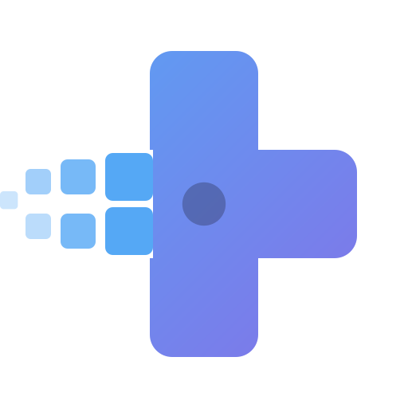
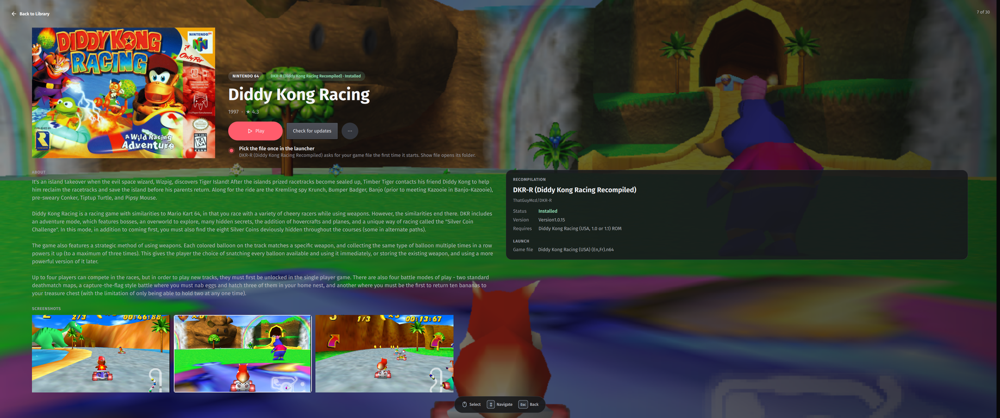
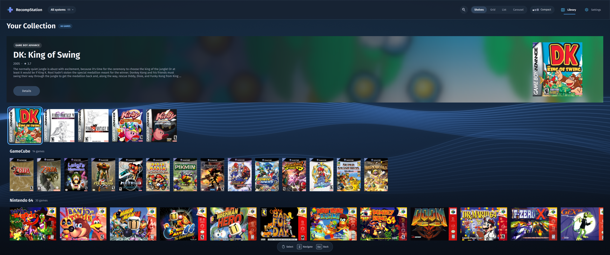
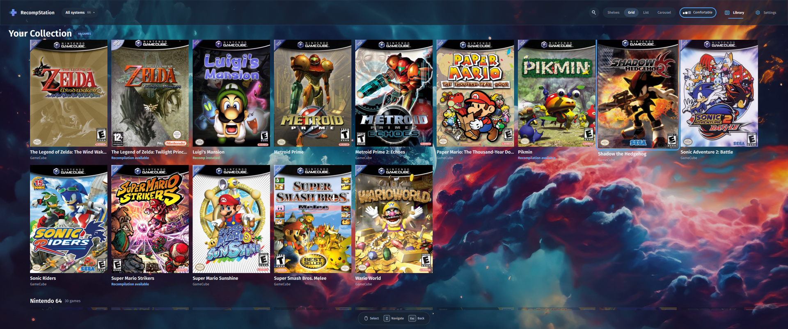
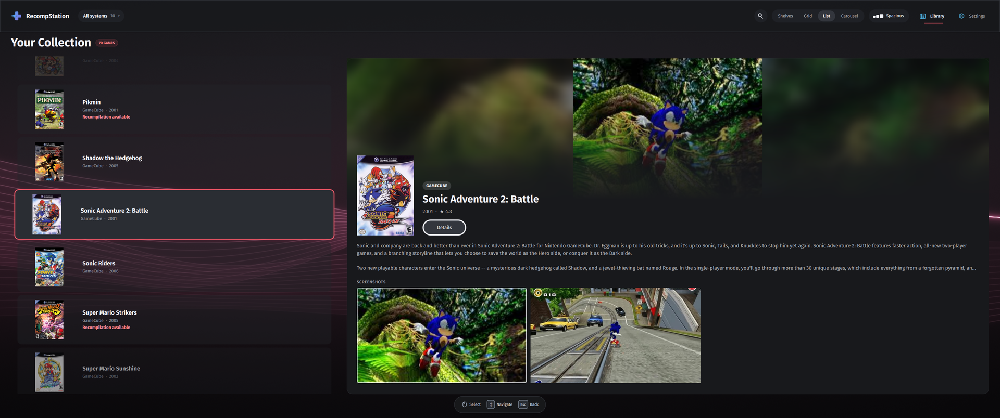
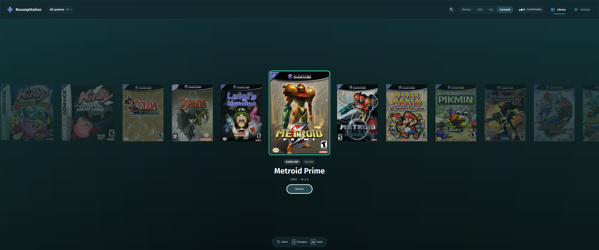

<div align="center">



# RecompStation

**A controller-first Linux launcher for native PC ports of classic console games.**

[](LICENSE)


</div>

> [!IMPORTANT]
> **RecompStation does not include, supply, host or distribute any games, ROMs, disc images, BIOS files or other copyrighted game data, and it never downloads them.**
> It works only with game files you provide yourself, which must come from games you legally own (for example, your own dumps of your own cartridges and discs).
> The recompilation projects RecompStation installs are downloaded directly from their authors' official GitHub releases. They also contain no game data, and they need your own copy of each game.
> RecompStation is an independent project. It is not affiliated with, endorsed by or sponsored by Nintendo, Sony, Microsoft or any other publisher, or by the authors of the recompilation projects. All trademarks belong to their respective owners.

## Summary

Native recompilation projects, such as *Zelda64Recomp*, *Banjo: Recompiled* and *Ship of Harkinian*, turn classic console games into native PC programs with modern features: high frame rates, widescreen, modern controls and mod support. Each one is a separate download with its own launcher, and each asks for your game file in its own way.

RecompStation brings them together in a single library that you can use from the couch with a controller. Point it at your games, and it identifies each system, fetches covers and descriptions, and finds the recompilation projects that support each game. It then installs a project's latest Linux release with one button, and when you press Play it gives your game file to the launcher, so the game opens straight away.

## Contents

- [Features](#features)
- [Screenshots](#screenshots)
- [Supported systems and projects](#supported-systems-and-projects)
- [Download and installation](#download-and-installation)
- [First start](#first-start)
- [Where RecompStation keeps its files](#where-recompstation-keeps-its-files)
- [Uninstalling](#uninstalling)
- [Contributing](#contributing)
- [License](#license)
- [Acknowledgements](#acknowledgements)

## Features

**A library built for the couch**
- Four views: Shelves, Grid, List with a preview, and a full-screen Carousel. Covers keep the box shape of their system.
- Complete controller, keyboard and mouse navigation. On-screen button hints match your controller (Xbox, PlayStation or Nintendo layouts) and your own button mapping.
- Platform filters, search, adjustable sizes, and a fullscreen interface with adjustable scale.
- Backgrounds: animated waves drawn on the GPU in a color you choose, your own wallpaper, or the theme's gradient. Four themes: Electric Blue, Midnight Violet, Aurora and Carbon.

**Your games, organised for you**
- First-time setup creates a library folder with one folder per system.
- **Add games** finds games in any folder you point it at, or files you drag onto the window. It identifies the system from each file's contents, not just its extension. It keeps multi-track `.cue` games together and unpacks zipped N64 ROMs. Your files are copied (or moved, if you choose) into the right folder, and existing files are never overwritten.
- The library is watched for changes, so games you add or remove appear right away.

**Covers, descriptions and screenshots**
- The [LaunchBox Games Database](https://gamesdb.launchbox-app.com/) works offline: one download, no account. [TheGamesDB](https://thegamesdb.net/) works online with your own free API key, entered in the app.
- Games are matched automatically, and only when one result clearly fits. A wrong cover is worse than none.

**One-button installs and one-button play**
- A curated catalog of recompilation projects. RecompStation shows which projects support each game, installs the latest Linux release (AppImage, ZIP or TAR.GZ), and can check for updates and uninstall.
- **Seamless play:** RecompStation checks your game file against the exact version each launcher needs, then gives it to the launcher, so most games open straight to the title screen.
  - If your copy is the wrong version or region, it tells you before you press Play.
  - Fullscreen can be switched on for every launcher, or chosen per game.
- Saves stay in each launcher's own folder, so updating or uninstalling a launcher never deletes them.

**Careful by design**
- Downloads come only from each project's official GitHub releases. Archives are unpacked with checks against path traversal, absolute paths and links.
- Your game files are only read. RecompStation never modifies, deletes or uploads them.

## Screenshots

**Game Details:** cover, description, screenshots, and the game's recompilation project: installed version, the game file it needs, and how it launches.



| Library: Shelves | Library: Grid |
| :---: | :---: |
|  |  |
| **Library: List** | **Library: Carousel** |
|  |  |

## Supported systems and projects

**Library systems:** Nintendo 64, PlayStation, GameCube, Wii, Xbox and Xbox 360. More systems are planned.

| System | Recognised files |
| --- | --- |
| Nintendo 64 | `.z64` `.n64` `.v64` (and `.zip` when adding games) |
| PlayStation | `.cue` + `.bin`, `.chd`, `.pbp`, `.iso`, `.img` |
| GameCube | `.iso` `.gcm` `.rvz` `.ciso` |
| Wii | `.iso` `.wbfs` `.rvz` |
| Xbox | `.iso` (XISO or full disc image) `.xiso` |
| Xbox 360 | `.iso` (XISO or full disc image) |

**Recompilation projects:** the catalog currently lists 32 projects for Nintendo 64, GameCube, PlayStation, Xbox and Xbox 360. They include Zelda64Recomp, Banjo: Recompiled, Ship of Harkinian, Star Fox 64 Recompiled, Mario Kart 64 Recompiled, MediEvil, Bloody Roar II, Shadow the Hedgehog, Ninja Gaiden Black, Lost Odyssey and The Simpsons Game. The full list, with the game version each project needs, is in [`data/projects.json`](data/projects.json) and on each game's page in the app.

A system appears in your library even if no recompilation project supports it yet, so you can keep your whole collection in one place.

## Download and installation

> [!NOTE]
> RecompStation is in active development. Prebuilt downloads for 64-bit Linux (x86_64) are on the [Releases page](https://github.com/MetalSJ13/RecompStation/releases); you can also build it from source (it takes a few minutes).

### Prebuilt downloads (64-bit Linux)

Each release has two files with the same contents; both include Qt, so nothing else needs installing:

- **AppImage** (`RecompStation-<version>-x86_64.AppImage`): one file. Make it executable (`chmod +x RecompStation-*.AppImage`, or Properties › Permissions in your file manager) and run it. If it doesn't start, your system may be missing FUSE 2: install `libfuse2` (`libfuse2t64` on Ubuntu 24.04), or use the zip.
- **Portable zip** (`RecompStation-<version>-linux-x86_64.zip`): unzip it anywhere and run `./RecompStation` inside the folder.

They run on Debian 12, Ubuntu 22.04, Fedora 36 and newer distributions (glibc 2.35 or newer). Each file's SHA-256 is listed in `SHA256SUMS` on the release page. ARM computers need to build from source for now.

### Building from source

#### Requirements

- Linux on x86_64 or ARM64 (developed on Arch Linux with KDE Plasma)
- Qt 6.5 or newer: Base (with the SQLite driver), Declarative, Svg and ShaderTools, plus Qt Wayland on Wayland sessions
- CMake 3.21+, Ninja and a C++20 compiler (GCC or Clang)
- libarchive
- SDL2 2.0.14+ (optional, for controller support and interface sounds; keyboard and mouse work without it)

#### Arch Linux and derivatives

```bash
git clone https://github.com/MetalSJ13/RecompStation.git
cd RecompStation
./scripts/install_dependencies.sh   # installs the packages above with pacman
./scripts/build.sh Release          # builds into ./build
./scripts/run.sh                    # starts RecompStation
```

#### Other distributions

Install the requirements above with your package manager, then run the same `build.sh` and `run.sh` commands. Make sure your distribution ships **Qt 6.5 or newer**; some long-term-support releases have older versions. Only Arch Linux has been tested so far.

#### Updating

```bash
cd RecompStation
git pull
./scripts/build.sh Release
```

To run the regression tests while building, add `--test`: `./scripts/build.sh Release --test`.

To build the two release files yourself (x86_64): `./scripts/package.sh` (they only run on systems as new as yours; the published ones are built on Ubuntu 22.04).

With a prebuilt download, update by downloading the new release and replacing the AppImage or the unzipped folder; your settings, library and installed launchers are kept.

## First start

1. **Choose a library folder.** RecompStation suggests `~/Games/RecompStation` (or `~/RecompStation` if you have no `~/Games` folder) and creates one folder per system inside it.
2. **Add games.** Point it at folders that already contain your games, or skip this and drag files onto the window later.
3. **Covers and information.** Download the LaunchBox catalog (once; about 500 MB on disk), and optionally add a TheGamesDB API key.
4. **Play.** Open a game, press **Install** for its recompilation project, then **Play**.

## Where RecompStation keeps its files

| What | Where |
| --- | --- |
| Settings, database, covers, logs, installed launchers | `~/.local/share/RecompStation/RecompStation/` |
| Your games | The library folder you chose (never modified) |
| Saves and settings of each launcher | The launcher's own folder, for example `~/.config/BanjoRecompiled/` or `~/.local/share/soh/` |

Logs are in `~/.local/share/RecompStation/RecompStation/logs/` (Settings › Application › Open log folder):
- `runtime.log`: what RecompStation did. Each session starts with a summary of your system, display, settings and library, and your home folder is written as `~`.
- `launchers/<project>.log`: the output of a game's launcher from its last run (the run before is kept as `.previous.log`).

Please attach both when reporting a problem. For a hard-to-reproduce problem, turn on **Detailed logging** in Settings › Application first, or start RecompStation with `RECOMPSTATION_DEBUG=1`.

## Uninstalling

Delete the AppImage, the unzipped folder or the folder you cloned, and `~/.local/share/RecompStation/`. Your library folder and the launchers' saves are left untouched. Delete those yourself if you no longer want them.

## Contributing

Bug reports and suggestions are welcome in [Issues](https://github.com/MetalSJ13/RecompStation/issues). Please include your distribution, desktop environment and the runtime log.

To suggest a recompilation project for the catalog, open an issue with a link to its repository. Projects are added when they publish native Linux builds (AppImage or archive) in their GitHub releases.

Development notes and the roadmap are in [`DEVELOPMENT.md`](DEVELOPMENT.md).

Please do not share or link to game files, ROMs or disc images in issues or pull requests.

## License

RecompStation is free software, released under the [GNU General Public License v3.0 or later](LICENSE). That includes the logo and the interface sounds, which were made for RecompStation; the sounds are synthesized by [`tools/sounds/generate.py`](tools/sounds/generate.py).

Third-party components:
- [xxHash](https://github.com/Cyan4973/xxHash), BSD 2-Clause License. See [`third_party/xxhash/LICENSE`](third_party/xxhash/LICENSE).
- Built with [Qt](https://www.qt.io/) (LGPL v3), [libarchive](https://www.libarchive.org/) (BSD) and [SDL2](https://www.libsdl.org/) (zlib). The release files include these libraries unmodified; their notices are in [`packaging/THIRD_PARTY_NOTICES.md`](packaging/THIRD_PARTY_NOTICES.md) and, in each download, in `THIRD_PARTY_NOTICES.md` with the LGPL text.

Each recompilation project installed through RecompStation is a separate program under its own license.

## Acknowledgements

RecompStation exists because of the people who build the recompilation projects and the tools behind them, including [N64Recomp](https://github.com/N64Recomp/N64Recomp), [N64ModernRuntime](https://github.com/N64Recomp/N64ModernRuntime), [RT64](https://github.com/rt64/rt64), [Harbour Masters](https://github.com/HarbourMasters) and the decompilation communities. Game information and artwork come from the [LaunchBox Games Database](https://gamesdb.launchbox-app.com/) and [TheGamesDB](https://thegamesdb.net/).
